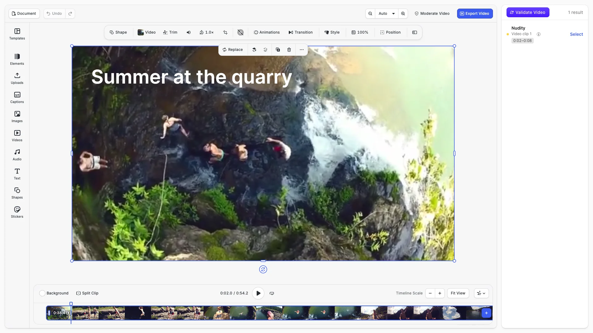

# Video Moderation Editor Starter Kit

Check every clip, image and text of a video before it is published. The editor sends them to the `imgly/detection` model on the IMG.LY Gateway, which scores video frames and images for nudity, weapons, drugs, alcohol, medical content, offensive symbols and gore, and text for harmful language. The sidebar lists what was flagged and when, and the export asks first when the video is not confirmed clean. Built with [CE.SDK](https://img.ly/creative-sdk) by [IMG.LY](https://img.ly).

<p>
  <a href="https://img.ly/docs/cesdk/js/starterkits/video-moderation-vmod01/">Documentation</a>
</p>



## Getting Started

### Clone the Repository

```bash
git clone https://github.com/imgly/starterkit-video-moderation-react-web.git
cd starterkit-video-moderation-react-web
```

### Install Dependencies

```bash
npm install
```

### Download Assets

CE.SDK requires engine assets (fonts, icons, UI elements). For production, serve them from your `public/` directory.

```bash
curl -O https://cdn.img.ly/packages/imgly/cesdk-js/1.87.0-rc.2/imgly-assets.zip
unzip imgly-assets.zip -d public/
rm imgly-assets.zip
```

Without further setup, the editor loads these assets from the IMG.LY CDN, which is for development only. To use the downloaded copy, set `baseURL: '/assets'` in the editor configuration in `src/index.tsx`. Add your license key to the same object as `license: 'YOUR_CESDK_LICENSE_KEY'`. Without a license key, the editor adds a watermark to exports.

### Configure the IMG.LY Gateway

The starterkit checks content with the `imgly/detection` model on the IMG.LY Gateway at `https://gateway.img.ly`. To run a check:

1. Create an API key in the [IMG.LY dashboard](https://img.ly/dashboard). The key needs access to `imgly/detection` and a credit balance.
2. Return the key from `getApiKey()` in `src/app/ai-credentials/ai-credentials.ts`:

```diff
-  const key = (undefined as string | undefined);
+  const key: string | undefined = 'YOUR_IMGLY_API_KEY';
```

Without a key, or with a key the gateway rejects, the starterkit shows a setup screen instead of the editor.

> **Heads up.** The key is sent from the browser. That's fine for local development. For production, change `resolveAiToken` in `src/app/ai-credentials/ai-credentials.ts` to return a short-lived token minted by your backend. See [Gateway Provider](https://img.ly/docs/cesdk/js/user-interface/ai-integration/gateway-provider-06df22/) for the pattern.

The model scores a frame every few seconds, so a long video costs more credits than a short one.

### Run the Development Server

```bash
npm run dev
```

Open `http://localhost:5173` in your browser.

## How It Works

- **Validate Video** in the sidebar, or **Moderate Video** in the navigation bar, checks every video clip, image, text and caption in the scene. Images and texts go first, at most four at a time, then the video files, one at a time.
- A video or image on a public `http(s)` URL is passed to the gateway as that URL. One the gateway cannot fetch, such as an upload (`blob:`) or a file on `localhost`, is uploaded first. An image is rendered as a JPEG for that.
- The gateway scores sampled frames of the whole video file. Each clip keeps only the frames inside the part that plays, so content you trim away does not flag the clip.
- Each video file is sent once per session. A trim, a split or a move changes only which frames count, so checking again after such an edit sends no video again.
- Each flagged category of a clip shows the times where it occurs, for example `0:02–0:06`. Click a time to select the clip and move the playhead there. **Select** on an image or a text moves the playhead to where it starts.
- **Export Video** asks first when the video was never checked, changed since the last check, has flagged content, or has a block that could not be checked.

### Use Your Own Moderation Service

Replace `detectVideo`, `detect` and `upload` in `src/app/gateway.ts`. `detectVideo` takes a video URL and returns the sampled frames of the whole file: the position of each frame in seconds and a score between 0 and 1 for each category. `detect` takes an image URL or a text and returns the scores. The rest of the kit does not change.

### Thresholds

`percentageToState` in `src/app/utils.ts` maps a score above 0.8 to failed and a score above 0.4 to a warning.

## Architecture

```
src/
├── app/
│   ├── ai-credentials/           # Gateway key, preflight check, onboarding screen
│   ├── components/Sidebar/       # Results list with flagged times
│   ├── App.tsx                   # Editor and sidebar layout
│   ├── export-gate.ts            # Asks before an unchecked or flagged export
│   ├── gateway.ts                # IMG.LY Gateway client (detectVideo, detect, upload)
│   ├── moderation-button.ts      # "Moderate Video" navigation bar button
│   ├── moderation-session.ts     # Shared check state and frame cache
│   ├── moderation.ts             # Clip, image and text scan; frame-to-result mapping
│   ├── types.ts                  # Moderation types
│   └── utils.ts                  # Thresholds, time format, select and seek
├── imgly/
│   ├── config/                   # Video editor configuration: actions, features, UI
│   ├── demo-assets.ts            # Demo asset URLs
│   └── index.ts                  # Editor initialization and asset sources
└── index.tsx                     # Application entry point
```

## Key Capabilities

- **Video Moderation** – Check every clip, image and text on the timeline
- **Policy Categories** – Nudity, weapons, drugs, alcohol, medical, offensive symbols, gore, and harmful language in text
- **Trim-aware Results** – Only the part of a clip that plays counts
- **Flagged Times** – Jump to the moment a category was detected
- **Export Check** – Confirm before exporting content that is not confirmed clean
- **Full Video Editor** – Timeline, clips, audio, text, captions and effects

## Prerequisites

- **Node.js v22+** with npm – [Download](https://nodejs.org/)
- **Supported browsers** – Chrome 114+, Edge 114+, Firefox 115+, Safari 15.6+

## Troubleshooting

| Issue                              | Solution                                                                         |
| ---------------------------------- | -------------------------------------------------------------------------------- |
| Editor doesn't load                | Verify assets are accessible at `baseURL`                                        |
| Assets don't appear                | Check `public/assets/` directory exists                                          |
| Watermark appears                  | Add your license key                                                             |
| Setup screen instead of the editor | Return your key from `getApiKey()` in `src/app/ai-credentials/ai-credentials.ts` |
| Some blocks "could not be checked" | The sidebar shows the reason under each block; run the check again               |
| Export asks before it starts       | Run the check again after your last change                                       |

## Documentation

For complete integration guides and API reference, visit the [Video Moderation Editor Documentation](https://img.ly/docs/cesdk/js/starterkits/video-moderation-vmod01/).

## License

This project is licensed under the MIT License - see the [LICENSE](LICENSE) file for details.

---

<p align="center">Built with <a href="https://img.ly/creative-sdk?utm_source=github&utm_medium=project&utm_campaign=starterkit-video-moderation-editor">CE.SDK</a> by <a href="https://img.ly?utm_source=github&utm_medium=project&utm_campaign=starterkit-video-moderation-editor">IMG.LY</a></p>
